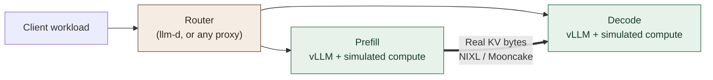

<div align="center">

<h1>☕ vllm-decaf</h1>

<p><strong>Real vLLM serving. Simulated compute. No GPU required.</strong></p>
<p>Same beans. Same cup. Hold the GPU.</p>

<p>
  <a href="#how-it-works">How it works</a> ·
  <a href="#whats-in-the-cup">Features</a> ·
  <a href="#why-decaf">Why Decaf?</a> ·
  <a href="#timing-models">Timing models</a> ·
  <a href="#first-brew">First brew</a> ·
  <a href="#testing-locally">Testing locally</a> ·
  <a href="#limitations">Limitations</a>
</p>

</div>

---

Decaf is real coffee: same beans, same cup, same ritual, with one active
ingredient taken out. **vllm-decaf does the same for LLM serving.** It keeps
vLLM's serving engine running and replaces model execution with simulated
compute. Requests still queue, cache blocks still get allocated, and KV bytes
still cross the network.

The result is a GPU-free environment for studying **disaggregated serving,
KV transport, routing, and cache behaviour** on CPU-only machines.

> vllm-decaf tries to follow upstream [vLLM](https://github.com/vllm-project/vllm)
> and keeps its Apache-2.0 license. It is currently based on upstream `main`
> at `v0.33.0rc0`.

## How it works

vllm-decaf is a **fork of [vLLM](https://github.com/vllm-project/vllm) with a
simulated worker**. Models are built on PyTorch's `meta` device from their
configuration, so model weights take no memory. The worker substitutes a
timing estimate for each compute step; everything around it is vLLM's own
code.



| Component | What runs |
| :--- | :--- |
| **Serving** | vLLM's API server, engine, scheduler and request lifecycle. |
| **KV cache** | vLLM's block allocation, prefix reuse and eviction, with model- and rank-specific layouts. |
| **Transport** | With real transfers, CPU buffers moved by vLLM's NIXL or Mooncake connector. |
| **Routing** | Whatever you put in front: the servers speak vLLM's API and emit its metrics and KV events. |
| **Model execution** | Simulated forward passes and token generation; step costs come from a timing provider. |

**The deployment runs live.** Change the network or the routing policy and the
engines react: queues, cache hits and transfer completion feed back into the
next scheduling decisions.

## What's in the cup

- **The real engine.** Continuous batching, chunked prefill, prefix caching,
  preemption and async scheduling are vLLM's, so a step's batch is the one a
  GPU deployment would form.
- **Step-level compute timing.** Each step is priced from its actual batch by
  a timing provider: a GPU performance model, a formula, or a recording of a
  real deployment.
- **Real KV transfers for disaggregated prefill/decode.** KV caches are real
  CPU buffers with the model's geometry, moved between instances by vLLM's
  own `NixlConnector` or `MooncakeConnector`, over TCP backends (Mooncake's
  TENT, UCX, libfabric), one NIC per rank if you want.
- **Byte-level verification.** Prefill can fill its KV blocks with a
  deterministic pattern and decode can check every byte it receives, with
  prefix caching on or off.
- **Many cache layouts.** Full and sliding-window attention, MLA, sparse MLA
  with an indexer, DeepSeek-V4's packed caches, and hybrid models with Mamba2
  or delta-net states.
- **Parallelism as deployed.** Tensor parallelism (different sizes on prefill
  and decode included), an MoE model's data-parallel attention with expert
  parallelism (one server, or one per rank for an external router), and
  native MTP speculative decoding.
- **Router-ready.** vLLM's metrics and KV events come from the real engine,
  so load-aware and prefix-aware routers see what they would see in
  production. The harness in this repository runs unmodified
  [llm-d](https://llm-d.ai).
- **Offline what-if runs.** A single-process driver replays timed requests
  and multi-turn sessions in simulated time, for sweeps that finish faster
  than real time.

## Why Decaf?

Other projects also take the GPU out of vLLM. They make different cuts, and
which one fits depends on what you need to stay real. This is a feature
comparison from each project's README at the time of writing; a dash means
the README does not describe it.

| | **vllm-decaf** | [vllm-vcr](https://github.com/neuralmagic/vllm-vcr) | [llm-d-inference-sim](https://github.com/llm-d/llm-d-inference-sim) |
| :--- | :--- | :--- | :--- |
| **What it is** | vLLM itself, with the forward pass simulated | A mock engine core behind vLLM's real frontend | A standalone server that mimics vLLM's API |
| **vLLM code that runs** | API server, engine, scheduler, KV cache manager, connectors | Frontend (tokenization, templates, API) | None (optional vLLM render server for tokenization) |
| **Compute time** | Per step, from the batch the scheduler formed: GPU performance model, formula or recorded steps | Replay of a recorded trace, or a latency model | Configured time to first token and inter-token latency, scaled with load |
| **KV cache** | vLLM's allocator, prefix cache and eviction | — | Tracked usage |
| **KV events** | vLLM's own | — | Published for allocation and eviction |
| **Prefill/decode transfer** | Real bytes, vLLM's NIXL or Mooncake connector, several TCP backends | Simulated KV bytes over NIXL | Transfer latency only |
| **Transferred bytes checked** | Every byte, optionally | — | Not applicable |
| **TP / DP / expert parallelism** | Yes, each rank with its own KV and NIC | — | — |
| **Speculative decoding** | Native MTP | — | — |
| **Model architecture matters** | Yes: cache geometry and timing follow the model | — | No (the name selects a tokenizer) |
| **LoRA adapters** | No | — | Lifecycle and metrics |
| **Failure injection** | No | — | Yes |


**Pick vllm-decaf** when the question is about the serving stack itself:
scheduling under load, cache reuse, what a router's choice does to the
engines, or what KV transfers cost on a network. **Pick the others** when you
need something lighter: llm-d-inference-sim to exercise control planes at
scale with many cheap replicas, vllm-vcr to record a deployment and replay or
inspect its traces.

## Timing models

A timing provider prices every step. Select it with `--simulation-config`:

| `timing` | A step costs | Use |
| :--- | :--- | :--- |
| **`aisimulate`** | [AISimulate](https://github.com/ai-dynamo/aisimulate)'s estimate for that batch of the published model on a given GPU | The main provider: GPU step times without a GPU or a recording |
| `linear` | A fixed cost plus per-token and per-request terms | Quick experiments and tests |
| `replay` / `table` | What a recorded real deployment took for the same (or the nearest) batch | Reproducing a deployment you have measured |
| `zero` | Nothing | Functional tests |

### AISimulate

`aisimulate` needs the optional AISimulate package, which the second image
adds on top of the CPU one:

```bash
docker build -f docker/Dockerfile.cpu --target vllm-openai \
  --build-arg VLLM_CPU_X86=true --build-arg ENABLE_AMX_FP8=0 \
  -t vllm:cpu .
docker build -f docker/Dockerfile.aisim -t vllm:cpu-aisim .
```

It times the **published model** you name (`target_model`) at its published
precision, on `gpu` `a100`, `h100`, `h200` or `b200`. A model or a layout
AISimulate has no data for is refused at startup instead of being guessed.

| | Supported |
| :--- | :--- |
| **Model families** | Llama, Qwen2/2.5, Qwen3 (dense and MoE), Qwen3-VL (text), Qwen3.5 (dense and MoE), Mixtral, gpt-oss, Gemma4, MiniMax-M2, MiMo-V2-Flash, Llama-3.3-Nemotron-Super, Nemotron-H and Nemotron-3, DeepSeek-V3, DeepSeek-V3.2, DeepSeek-V4, GLM-5, Kimi-K2/K2.5, Kimi-K3 |
| **Layouts** | Tensor parallelism (1, 2, 4 or 8) on one node; for MoE models, data-parallel attention with expert parallelism (up to 8 ranks on one host) |
| **Speculative decoding** | The native single-module MTP of DeepSeek-V3, DeepSeek-V3.2, GLM-5, DeepSeek-V4 and Qwen3.5 (1 to 5 tokens) |

Anything else is refused at startup: pipeline and context parallelism, EPLB,
tensor parallelism combined with data parallelism, and a single instance
whose ranks are spread over several hosts (wide expert parallelism across
nodes). Wide EP on one host is the supported data-parallel layout above, and
separate instances, such as prefill and decode, can sit on different hosts.

Which of the supported models also move real KV, over which connector, is listed in the
[documentation](docs/features/simulated_execution.md#real-kv-transfers).

## First brew

You need Docker and an x86-64 Linux host. No GPU, no weights.

1. Build the image (once):

   ```bash
   docker build -f docker/Dockerfile.cpu --target vllm-openai \
     --build-arg VLLM_CPU_X86=true --build-arg ENABLE_AMX_FP8=0 \
     -t vllm:cpu .
   ```

2. Serve a model by its Hugging Face name, as with vLLM. The image's
   entrypoint is `vllm serve`; `--simulate-forward` takes the GPU out, and
   only the model's **configuration and tokenizer** are downloaded, never
   its weights:

   ```bash
   docker run --rm -p 8000:8000 -e TRITON_CPU_BACKEND=1 \
     vllm:cpu Qwen/Qwen3-8B \
     --simulate-forward \
     --kv-cache-memory-bytes 1073741824 \
     --max-model-len 4096 \
     --simulation-config '{"timing": "linear",
                           "timing_args": {"fixed_us": 3000,
                                           "prefill_us_per_token": 20,
                                           "decode_us_per_req": 40}}'
   ```

3. Talk to it like any vLLM server:

   ```bash
   curl localhost:8000/v1/completions -H 'Content-Type: application/json' \
     -d '{"model": "Qwen/Qwen3-8B", "prompt": "Same beans, same cup:", "max_tokens": 16}'
   ```

   The reply has real usage counts and timing; the text is filler, because
   no model ran.

For GPU step times, build `vllm:cpu-aisim` as above, use it in step 2 and
swap the simulation config. The model's name also names the deployment
AISimulate times:

```bash
     --simulation-config '{"timing": "aisimulate", "timing_args": {"gpu": "h100"}}'
```

A local directory with a model's configuration and tokenizer works in place
of the name (mount it and pass its path); `target_model` in `timing_args`
then names the published model.

`--kv-cache-memory-bytes` is the KV budget of the deployment you model:
prefix-cache hits and preemption depend on it. Any client works unchanged,
including `vllm bench serve`. Prefill/decode pairs, real KV transfers, the
offline driver and recording a real deployment are covered in the
[documentation](docs/features/simulated_execution.md).

## Testing locally

`tools/e2e` holds the harness this fork is validated with. It builds a
topology of Docker containers joined by separate control and KV networks,
serves a prefill/decode run behind unmodified llm-d (Envoy, the endpoint
picker and the disaggregation sidecar, without Kubernetes), and checks the
outcome. It needs Linux, Docker, Python 3.10+, and `ip`, `tc` and `nsenter`
through passwordless `sudo`.

```bash
cd tools/e2e
python -m venv .venv && .venv/bin/python -m pip install -r requirements.txt

.venv/bin/python -m harness up topologies/example.yaml
.venv/bin/python -m harness run runs/example.yaml
.venv/bin/python -m harness down example
```

Before the first run, adapt the CPU sets, memory limits and subnets in
[`topologies/example.yaml`](tools/e2e/topologies/example.yaml) to your host.
[`runs/example.yaml`](tools/e2e/runs/example.yaml) names its model by its
Hugging Face id; the harness fetches the configuration and tokenizer once
(no weights) and gives them to the servers, which run without internet
access. Both files document every option; copy them to make your own.

A run writes its evidence to `results/<name>-<timestamp>/`: client metrics,
server and router logs, per-rank transfer records and `verdict.json`. It
passes when the verdict's `problems` list is empty, which means, among other
things, that every transferred byte matched and every request ran on the
instances the router picked. `harness recheck <directory>` validates saved
evidence again without starting anything.

Use byte checking for correctness runs and turn it off for performance runs:
writing and comparing patterns costs CPU time and memory bandwidth.

## Limitations

- **Tokens are filler.** Only their counts and timing mean something; KV
  contents are synthetic.
- **Latency is as good as the timing provider.** Scheduling, caching and
  transfers run for real; compute time is an estimate. AISimulate covers the
  models, GPUs and single-node layouts listed above, and its own
  approximations apply.
- **Real KV transfers currently focus on TCP stacks.** They run on the CPU
  platform over TCP backends; RDMA is not covered yet, nor are pipeline and
  context parallelism.
- **Per-model scope.** Each cache layout is supported for specific
  connectors and parallel layouts; unsupported combinations are refused at
  startup.
- **Memory.** Real transfers allocate every rank's KV buffers in host
  memory.
- **Not simulated.** LoRA adapters, pooling and diffusion models, and
  speculative decoding other than native MTP with real transfers.

The full list, with every supported model, connector and layout, is in
[docs/features/simulated_execution.md](docs/features/simulated_execution.md).

---

<p align="center"><em>The packets are real. The caffeine is simulated.</em></p>
