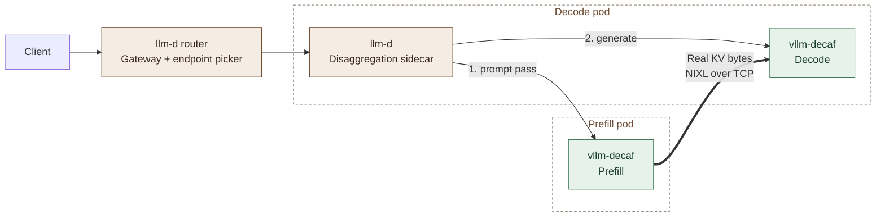

# vllm-decaf as llm-d's prefill and decode servers

The two model-server Deployments of a prefill/decode setup behind
[llm-d](https://llm-d.ai) v1.0, with vllm-decaf in place of GPU servers: real
vLLM with simulated compute. No GPU is requested.



| File | Contents |
| :--- | :--- |
| `prefill.yaml` | Prefill pods: vllm-decaf as the KV producer. |
| `decode.yaml` | Decode pods: llm-d's disaggregation sidecar (unmodified) in front of vllm-decaf as the KV consumer. |

What is real: vLLM's scheduling, metrics and KV cache on both sides, the
sidecar's two-step request, and the KV bytes that cross the pod network.
What is simulated: the forward pass, timed by AISimulate as an H100 would
run the published model.

## Before you apply

1. **The image.** Build `vllm:cpu-aisim` (see the repository README) and make
   it available to the cluster: push it to a registry the nodes can pull from
   and set `image` in both files, or load it into the nodes' container
   runtime.
2. **Internet access from the pods**, or a Hugging Face mirror: each server
   downloads its model's configuration and tokenizer at startup (a few MB,
   never the weights).

## Deploy

```bash
kubectl apply -n <namespace> -f deploy/llm-d/
kubectl -n <namespace> rollout status deploy/vllm-decaf-prefill deploy/vllm-decaf-decode
```

Send a request through the router's gateway with model
`Qwen/Qwen3-8B`. The reply has real usage counts and timing; its text is
filler. To see that the request was disaggregated, look at where decode's
prompt tokens came from:

```bash
kubectl -n <namespace> exec deploy/vllm-decaf-decode -c vllm-decode -- \
  curl -s localhost:8200/metrics | grep prompt_tokens_by_source_total
```

`source="external_kv_transfer"` counts the prompt tokens whose KV cache
decode pulled from a prefill pod instead of computing.

## Make it yours

- **Model and GPU.** Change the model name in both files and `gpu` in
  `--simulation-config` (`a100`, `h100`, `h200`, `b200`). The model must be
  one AISimulate times; see the supported list in the repository README. For
  a quick test without AISimulate, use the `vllm:cpu` image and
  `"timing": "linear"` with `timing_args`.
- **Sizes.** `--kv-cache-memory-bytes` is real host memory per pod: it holds
  the KV buffers. Set it, and the pods' memory, to what your nodes allow.
- **Replicas.** Scale the two Deployments independently.
- **A dedicated KV network.** These manifests move KV over the pod network.
  With a secondary network (Multus, say), point `VLLM_NIXL_SIDE_CHANNEL_HOST`,
  `NIXL_MOONCAKE_IP_ADDR` and the addresses in `MC_TENT_CONF` at the pod's
  address on it.
- **The KV connector.** See below.

## Changing the KV connector

As written, KV moves through vLLM's `NixlConnector` on NIXL's Mooncake
backend (Mooncake's transfer engine over TCP). The other TCP paths are a
few edits to **both** `prefill.yaml` and `decode.yaml`:

| KV path | `--kv-transfer-config` | Environment | Sidecar |
| :--- | :--- | :--- | :--- |
| **NIXL over Mooncake** (as written) | `"kv_connector": "NixlConnector"`, `"backends": ["Mooncake"]` | as written | `--kv-connector=nixlv2` |
| **NIXL over UCX** | `"backends": ["UCX"], "rank_addresses": ["$(POD_IP)"]` | remove `MC_USE_TENT`, `MC_TENT_CONF`, `NIXL_MOONCAKE_IP_ADDR`; add `UCX_TLS=tcp,self` | unchanged |
| **NIXL over libfabric** | `"backends": ["LIBFABRIC"], "rank_addresses": ["$(POD_IP)"]` | remove the same three; add `FI_PROVIDER=tcp`, `FI_ADDR_FORMAT=FI_SOCKADDR_IN`, `FI_PREFER_SYSCONFIG=0` | unchanged |
| **vLLM's `MooncakeConnector`** | `"kv_connector": "MooncakeConnector"`, `"kv_connector_extra_config": {"mooncake_protocol": "tcp"}` | remove `VLLM_NIXL_SIDE_CHANNEL_HOST`, `NIXL_MOONCAKE_IP_ADDR`; add `VLLM_MOONCAKE_BOOTSTRAP_PORT=8998` | `--kv-connector=mooncake --mooncake-bootstrap-port=8998` |

`kv_role` and `kv_buffer_device` stay as they are. Kubernetes expands
`$(POD_IP)` inside `args` as it does inside `env`, so `rank_addresses` can
name the pod's address directly; UCX and libfabric bind to the interface
that holds it.
